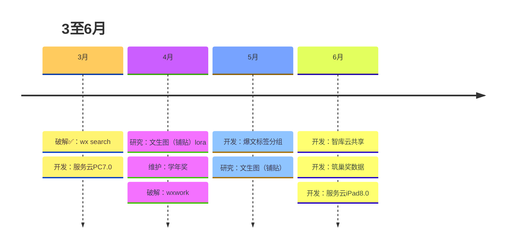
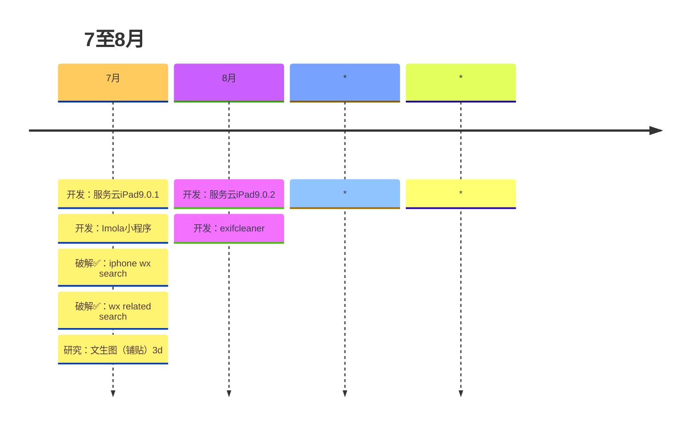

## 序

昨晚（2025-8-14）在太湖边待到了凌晨一点，太湖的风凉爽安逸，非常适合露营。

当耳机中听到“<mark class="mk mk-note">你看那时间等过谁...</mark>”这首歌，突然意识到时间不等人，距离上次家人真正一起团聚已经是4年前的事情了。

今天新华社在抖音发了一个视频，分享一个博主的人生感悟：现在起一定要多拍照，多发朋友圈。不要在乎别人的眼光，我们没有那么多的观众，留下文字和图片，当我们走不了的时候，光看朋友圈就能看几十年。

当然我不会在朋友圈经常发私人的动态，我觉的把我所思所想在我的个人网站上分享更合适（反正大家都不认识😄）。

---

## 工作上

### 01·苟！

从2019年末开始至今，给我的感觉就是经济越来越不景气。我们应该正处在产业转型的阶段，随着生产力的再次提升，曾经的辉煌行业逐渐会被淘汰，这是外部环境变化我们个人左右不了，大势所趋。这个世界不变的就是一直在变化，如何在变化中求生存，就得拥抱变化。如果固步自封或认错方向，只会像老牛拉车一样，拼命努力的半天还在自己的一亩三分地被人抽着鞭子。

### 02·认清形势，认清自我
8月1日集团开了半年总结会，我深有体会，公司都如此举步维艰，我们个人更应该适者生存，否则就会被淘汰掉。

在意识和行为上要对我自己有严格要求，主要两点：**认清形势**和**具体怎么做**。

#### 认清形势

> **乱**
>> <mark class="mk mk-note">**外界乱云飞渡，我要处乱不惊**</mark>；不要点看、不要看、不要交谈 。

> **强烈的危机感**
>> 问自己，回答：“<mark class="mk mk-note">**裁员三分之一有我吗？裁员三分之二有我吗？**</mark>”
>> 像个军人一样：**叫醒自己、死磕自己、重塑自己、改变自己、强大自己、超越自己。**

#### 具体怎么做--四大纪律

##### 1·自知自律自强
① 自知：知道自己是谁，自己是干什么的。
② 自律：永远不要和别人解释自己、不要抱怨。
② 自强：用百分之一百的结果证明自己。

##### 2·行为——<em class="mk mk-em">做不到位，一切都是扯淡</em>
<mark class="mk mk-hl">摆事实，绝不讲道理！</mark>
① 按照要求自律干，不要解释抱怨
② 利益上按照规则，不要讨价还价
③ 要用行动证明自己，不要用想法看法证明自己

##### 3·时间
五个时间点：
① 立即：紧急事情处理时间点
② 马上：重要事情处理时间点
③ 当天：当天每件事的时间点
④ 24小时：每件事24小时的时间点
⑤ 一周：每件事的最终关门时间（底线）

##### 4·意识--尊重和敬畏
① 用最有效简洁的方式表达
② 控制好情绪；好好说话，别急
③ <mark class="mk mk-hl">先肯定，再否定，再肯定</mark>（方法论，辩证法，“顺势而为”）

### 03·杂项



---

## 学习上

### 01·AI

AI工具已经成为我日常工作的得力助手，我主要用ChatGPT、Claude和豆包。Claude绝对是编程利器，基本上开发一个程序我只要持续的按回车（↩︎）即可，往年需要几个小时或几天的工作，现在只需要几分钟。效率就是生产力和竞争力👍。

### 02·破解（仅仅用于学习，咱不做违法事情）

今年在破解上主要成果是破解了<em class="mk mk-em">微信</em>，现在微信对于我来说是手拿把掐。虽然微信最新版的4.0使用了C++重构了，但也还是很容易破解。
被破解的状态截图（带<code class="mk mk-code">vConsole</code>和<code class="mk mk-code">已破解</code>字样）如下：


---

## 生活上

### 🚗汽车里程（单位:公里）

5月份竟跑了3160多公里😮
```echarts
option = {
    xAxis: {
        type: 'category',
        data: ['3月', '4月', '5月', '6月', '7月', '8月']
    },
    yAxis: {
        type: 'value'
    },
    series: [{
        data: [1061.3, 703.1, 3160.3, 580.5, 779.6, 397.1],
        type: 'bar'
    }]
};
```

### ✈️即兴出行
5月31日忽然来了兴致，不做规划直接前往皖南，赶上了一场烟雨江南的美景。
<video width="1280" height="720" poster="https://static.imolacn.com/xqk/mweb/2025081517552450663290.mov?vframe/jpg/offset/1" preload="none" controls><source src="https://static.imolacn.com/xqk/mweb/2025081517552450663290.mov" type="video/mp4" /></video>

### 🥱处理矛盾

处理组合家庭矛盾，没什么好说的，我既不是当事人，也不是肇事者。感觉他们这种内耗的人群好无聊。我要抱着积极向上的心态拥抱工作和生活，对消极的人和事远离即可！

---

## 尾

很庆幸的是，时至今日，我觉得我还处于一种时刻学习的状态中，希望我能把这种状态坚持到死。
