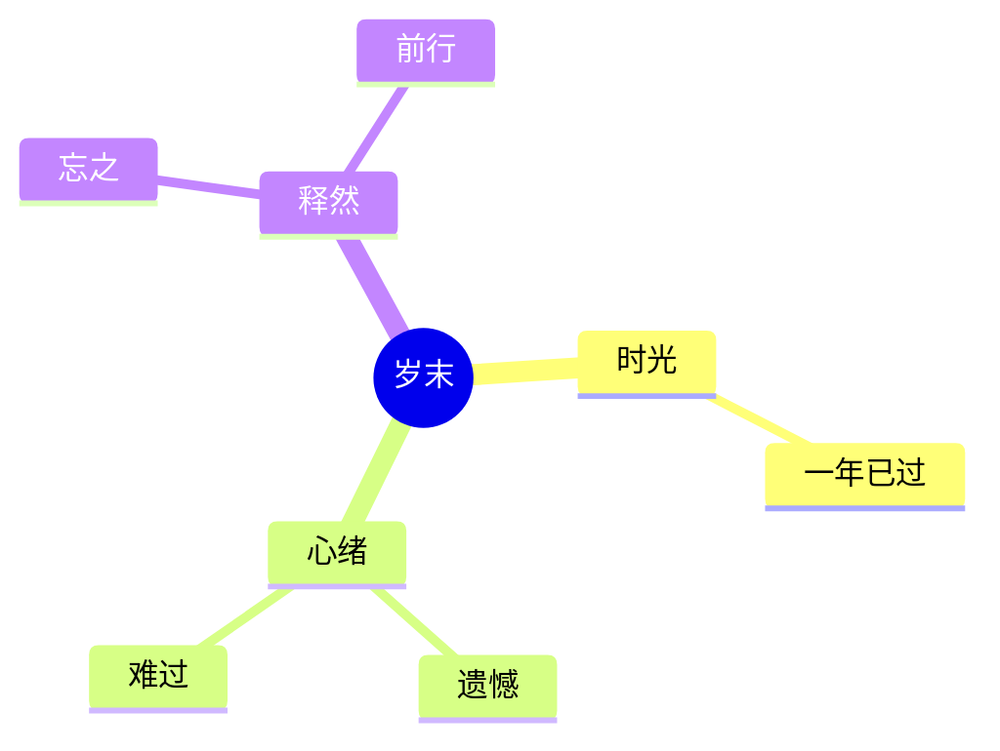

一年就这么过去了，该遗憾该难过的，都忘记吧。

## 工作和学习

### 工作
今年工作上重要的心得体会是：认清形势，认清自我。
这个世界不变的就是一直在变化，如何在变化中求生存，就得拥抱变化。如果固步自封或认错方向，只会像老牛拉车一样，拼命努力的半天还在自己的一亩三分地被人抽着鞭子。

> **乱**
>> <mark class="mk mk-note">**外界乱云飞渡，我要处乱不惊**</mark>；不要点看、不要看、不要交谈 。

> **强烈的危机感**
>> 问自己，回答：“<mark class="mk mk-note">**裁员三分之一有我吗？裁员三分之二有我吗？**</mark>”
>> 像个军人一样：**叫醒自己、死磕自己、重塑自己、改变自己、强大自己、超越自己。**

**4大纪律：**

① 自知自律自强
② 摆事实，绝不讲道理
③ 时间：立即、马上、当天、24小时、一周
④ 意识--尊重和敬畏

### 代码贡献
<figure class="card card--multi-column">
<section class="heti--columns-1">

```echarts
option = {
  title: {
    top: 30,
    left: 'center',
    text: 'gitlab（次）'
  },
  tooltip: {
    position: 'top',
    formatter: function (p) {
      const format = echarts.time.format(p.data[0], '{yyyy}-{MM}-{dd}', false);
      return format + ': ' + p.data[1] + '次';
    }
  },
  visualMap: {
    show: true,
    min: 0,
    max: 20,
    calculable: true,
    orient: 'horizontal',
    left: 'center',
    top: 'bottom'
  },
  calendar: [
    {
        top: 120,
        range: '2025',
        cellSize: [15, 15]
    }
  ],
  series: [
    {
    type: 'heatmap',
    coordinateSystem: 'calendar',
    calendarIndex: 0,
    data: [["2025-01-07",6],["2025-01-16",3],["2025-02-21",1],["2025-02-26",1],["2025-03-01",2],["2025-03-04",1],["2025-03-11",6],["2025-03-12",2],["2025-03-13",16],["2025-03-25",2],["2025-04-07",10],["2025-04-08",1],["2025-04-15",1],["2025-04-17",1],["2025-04-18",1],["2025-04-22",2],["2025-04-25",3],["2025-05-05",1],["2025-05-12",1],["2025-05-14",1],["2025-05-15",3],["2025-05-16",10],["2025-05-20",5],["2025-05-21",1],["2025-06-04",3],["2025-06-08",1],["2025-06-11",1],["2025-06-14",1],["2025-06-19",2],["2025-07-05",2],["2025-07-09",1],["2025-07-10",1],["2025-07-11",1],["2025-07-16",6],["2025-07-17",16],["2025-07-21",7],["2025-07-22",7],["2025-07-23",6],["2025-07-24",4],["2025-07-25",1],["2025-07-29",4],["2025-07-31",3],["2025-08-01",1],["2025-08-06",1],["2025-08-07",9],["2025-08-08",7],["2025-08-09",3],["2025-08-10",2],["2025-08-11",3],["2025-08-12",2],["2025-08-13",4],["2025-08-14",5],["2025-08-18",6],["2025-08-20",1],["2025-08-21",2],["2025-08-22",1],["2025-08-26",3],["2025-08-27",3],["2025-08-28",1],["2025-09-02",5],["2025-09-08",4],["2025-09-09",5],["2025-09-12",4],["2025-09-16",1],["2025-09-18",4],["2025-09-19",2],["2025-09-23",3],["2025-09-25",2],["2025-09-27",1],["2025-09-29",4],["2025-09-30",3],["2025-10-23",1],["2025-10-27",2],["2025-10-28",8],["2025-10-29",4],["2025-10-30",5],["2025-10-31",12],["2025-11-01",1],["2025-11-03",1],["2025-11-05",8],["2025-11-06",2],["2025-11-07",1],["2025-11-08",1],["2025-11-19",3],["2025-11-20",3],["2025-11-21",7],["2025-11-24",3],["2025-11-26",1],["2025-12-09",2],["2025-12-17",4],["2025-12-19",8],["2025-12-20",3],["2025-12-26",5],["2025-12-29",27],["2025-12-30",18],["2025-12-31",5]]
  }
  ]
};
```

```echarts
option = {
  title: {
    top: 30,
    left: 'center',
    text: 'github（级）'
  },
  tooltip: {
    position: 'top',
    formatter: function (p) {
      const format = echarts.time.format(p.data[0], '{yyyy}-{MM}-{dd}', false);
      return format + ': ' + p.data[1] + '级';
    }
  },
  visualMap: {
    show: true,
    min: 0,
    max: 4,
    calculable: true,
    orient: 'horizontal',
    left: 'center',
    top: 'bottom'
  },
  calendar: [
    {
        top: 120,
        range: '2025',
        cellSize: [15, 15]
    }
  ],
  series: [
  {
    type: 'heatmap',
    coordinateSystem: 'calendar',
    calendarIndex: 0,
    data: [["2025-02-16",2],["2025-01-20",4],["2025-01-27",3],["2025-02-10",3],["2025-08-25",2],["2025-09-22",2],["2025-01-28",2],["2025-08-12",2],["2025-08-19",2],["2025-12-16",2],["2025-12-23",2],["2025-01-08",4],["2025-01-22",2],["2025-03-19",2],["2025-04-30",2],["2025-07-30",2],["2025-08-20",3],["2025-08-21",2],["2025-08-28",2],["2025-02-21",2],["2025-03-07",2],["2025-08-15",2],["2025-01-18",2],["2025-01-25",2],["2025-03-01",2]]
  }
  ]
};
```

</section>
</figure>

### 学习
破解了微信和企业微信，虽然微信新版用了C++重构，也还是可以破解。

忙活了一天，当数据出现的那一刻，我血压400、心跳190，我艹微信就这么被我拔开了外壳😄什么腾讯自研mmtls加密传输，狗屁！老子不从传输层直接从内存中下手获取解密后的数据🎉
<video width="1280" height="720" poster="https://static.imolacn.com/xqk/mweb/2026010117672484917091.jpeg" preload="none" controls><source src="https://static.imolacn.com/xqk/mweb/2026010117672485170754.mov" type="video/mp4" /></video>


## 生活

### 南太行3日游


### 皖南两日游
<video width="1280" height="720" poster="https://static.imolacn.com/xqk/mweb/2025081517552450663290.mov?vframe/jpg/offset/1" preload="none" controls><source src="https://static.imolacn.com/xqk/mweb/2025081517552450663290.mov" type="video/mp4" /></video>

### 川西甘南12日环游


**新都桥 318 服务区**
<video width="1280" height="720" poster="https://static.imolacn.com/xqk/mweb/2025123117671897080517.jpeg" preload="none" controls><source src="https://static.imolacn.com/xqk/mweb/2025123117671899292908.mov" type="video/mp4" /></video>


**丹巴露营**
<iframe src="//player.bilibili.com/player.html?isOutside=true&aid=115815001101370&bvid=BV1ZpiGBQErc&cid=35107637010&p=1" scrolling="no" border="0" frameborder="no" framespacing="0" allowfullscreen="true" width="672" height="1195"></iframe>

**卓克基土司官寨**
<video width="1280" height="720" poster="https://static.imolacn.com/xqk/mweb/2025123117671898371606.jpeg" preload="none" controls><source src="https://static.imolacn.com/xqk/mweb/2025123117671898770912.mov" type="video/mp4" /></video>

**若尔盖大草原**
<video width="1280" height="720" poster="https://static.imolacn.com/xqk/mweb/2025123117671899931206.jpeg" preload="none" controls><source src="https://static.imolacn.com/xqk/mweb/2025123117671900143595.mov" type="video/mp4" /></video>

**拉卜楞寺**


**米拉日巴佛阁**


### 老爸心脏手术
老爸年龄大了（72 岁），老年病越来越明显了。算起来这是我第4次救老爸了。虽然我是老三（我老小，有一哥一姐），但我承担了**绝大部分**医药费（算起来有119个医药账单），我只求问心无愧。在人们朴素的价值观里，家人朋友生病或遭难一定会及时伸出援手。还好老爸的心脏手术挺顺利的。


### 中奖
江苏工会[“求学圆梦”](https://www.jsgh.org/art/2025/7/31/art_3577_96317.html)活动我中签了～ 得到1000块补助～😄
只要积极向上的学习进步，好运随时都会到来～


## 收尾词


